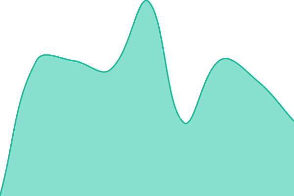

# [📈 Live Status](https://dijonkitchen.org): <!--live status--> **🟩 All systems operational**

This repository contains the open-source uptime monitor and status page for [JC (Jonathan Chen)](https://www.dijonkitchen.org/), powered by [Upptime](https://github.com/upptime/upptime).

With [Upptime](https://upptime.js.org), you can get your own unlimited and free uptime monitor and status page, powered entirely by a GitHub repository. We use [Issues](https://github.com/dijonkitchen/statup/issues) as incident reports, [Actions](https://github.com/dijonkitchen/statup/actions) as uptime monitors, and [Pages](https://dijonkitchen.org) for the status page.

<!--start: status pages-->
<!-- This summary is generated by Upptime (https://github.com/upptime/upptime) -->
<!-- Do not edit this manually, your changes will be overwritten -->
<!-- prettier-ignore -->
| URL | Status | History | Response Time | Uptime |
| --- | ------ | ------- | ------------- | ------ |
|  [dijonkitchen.org](https://www.dijonkitchen.org/) | 🟩 Up | [dijonkitchen-org.yml](https://github.com/dijonkitchen/statup/commits/HEAD/history/dijonkitchen-org.yml) | 

 324ms
     
 | 

<a href="https://dijonkitchen.github.io/statup/history/dijonkitchen-org">100.00%</a>
    

|  [Bare domain (dijonkitchen.org)](https://dijonkitchen.org/) | 🟩 Up | [bare-domain-dijonkitchen-org.yml](https://github.com/dijonkitchen/statup/commits/HEAD/history/bare-domain-dijonkitchen-org.yml) | 

 469ms
     
 | 

<a href="https://dijonkitchen.github.io/statup/history/bare-domain-dijonkitchen-org">100.00%</a>
    

|  [Feed](https://www.dijonkitchen.org/feed.xml) | 🟩 Up | [feed.yml](https://github.com/dijonkitchen/statup/commits/HEAD/history/feed.yml) | 

 139ms
     
 | 

<a href="https://dijonkitchen.github.io/statup/history/feed">100.00%</a>
    

<!--end: status pages-->

[**Visit our status website →**](https://dijonkitchen.org)

## 📄 License

- Powered by: [Upptime](https://github.com/upptime/upptime)
- Code: [MIT](./LICENSE) © [JC (Jonathan Chen)](https://www.dijonkitchen.org/)
- Data in the `./history` directory: [Open Database License](https://opendatacommons.org/licenses/odbl/1-0/)
